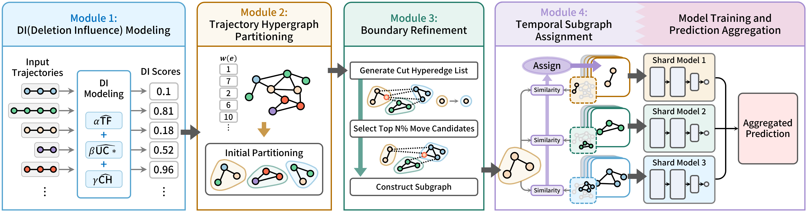

<h1 align="center">GUTS</h1>

<p align="center">
  <b>Efficient Large-Scale Graph Unlearning through Trajectory-Aware Sharding</b>
</p>

<p align="center">
  <a href="#overview">Overview</a> ·
  <a href="#requirements">Requirements</a> ·
  <a href="#yjmob">YJMob</a> ·
  <a href="#configuration">Configuration</a>
</p>

## Overview

GUTS is a shard-based graph unlearning framework for trajectory data. The training graph is
split into K shards with one model each, and a deletion request retrains only the shards whose
training data contain the deleted data. GUTS builds the shards so that a request touches few
shards and trajectories stay inside one shard.

| Component | Paper | Code |
|---|:---:|---|
| **Deletion Influence** — how far a trajectory's deletion would spread over shards (TF, UC\*) | §4.1 | `guts/partition/partitioner.py` |
| **Hypergraph partitioning** — trajectories as weighted hyperedges, partitioned with KaHyPar | §4.2 | `guts/partition/partitioner.py` |
| **Boundary Refinement** — moves boundary nodes to reduce fragmentation and cross-shard transitions | §4.3 | `guts/partition/refinement.py` |
| **Temporal Subgraph Assignment** — maps each day's shards to the persistent shard models | §4.4 | `guts/partition/assignment.py` |

The code covers **YJMob** (large-scale grid trajectories, next-location prediction) and
**Cora** (static citation graph, node classification).



The figures in the paper can be reproduced with the notebooks in `Analysis/`.

## Repository layout

```
configs/                 yjmob_14d.yaml, cora.yaml
guts/
  config.py              YAML config loader
  shard.py               partition -> per-shard PyG subgraphs
  partition/             GUTS partitioner (§4.1-§4.4) and its KaHyPar preset
  yjmob/
    pipeline.py          entry point: partition -> shard training -> evaluation
    stage_partition.py   STEP 1  partition every training day
    stage_train.py       STEP 2  shard datasets + one model per shard
    stage_eval.py        STEP 3  shard routing evaluation
    data/                preprocess.py, shard_data.py, rolling_graphs.py
    model/               GraphSAGE + GRU model, train_single.py, train_multi_gpu.py
    unlearning/          forget sets, unlearning (batch and stream)
  cora/                  Cora pipeline, unlearning, forget sets, clean data
processed/               datasets, forget sets, clean data (not committed)
Results/                 run outputs (not committed)
Analysis/                notebooks for the paper figures
assets/                  README images
```

## Requirements

```
python 3.9
torch 1.13.1 (CUDA 11.7)   torch_geometric 2.0.4   kahypar 1.3.6
numpy 1.26   scipy 1.13   pandas 2.3   scikit-learn 1.6   pyyaml 6.0   tqdm 4.67
```

## Experimental environment

> - **OS** Ubuntu 22.04.5 LTS
> - **CPU** Intel Core i9-10980XE (18 cores, 36 threads)
> - **GPU** 4 × NVIDIA GeForce RTX 3080 (10 GB)
> - **Memory** 128 GB

## YJMob

Run every command from the repository root.

### 1. Data

Put `yjmob100k-dataset1.csv` of the YJMob100K dataset (sorted by `uid`) in
`processed/yjmob/raw/`, then build the 14-day dataset used by `configs/yjmob_14d.yaml`:

```bash
python guts/yjmob/data/preprocess.py --dataset_name dataset1 --day_range 0 13 --out_name yjmob_1_14d
```

Each user's sessions are split 70/10/20 into train/val/test. The output also holds one
transition graph per day and the per-day train trajectories read by the partitioner.

### 2. Partition, train, evaluate

```bash
python guts/yjmob/pipeline.py --config configs/yjmob_14d.yaml --num-gpus 4

# quick check on a few days
python guts/yjmob/pipeline.py --config configs/yjmob_14d.yaml --num-gpus 4 \
    --days 0 1 2 3 4 --override training.epochs=3
```

| Step | |
|:---:|---|
| 1 | Partition every training day into K shards. |
| 2 | Build one dataset per shard and train one GraphSAGE + GRU model per shard. The graph for day *d* merges the shard's graphs of the previous `window_size` days. |
| 3 | **Shard routing evaluation** — each test step of day *d* goes to the shard that held its current cell most often in the partitions before day *d*, and that shard's model predicts the next cell (ACC@1/5/10, MRR). |

Results are written to `Results/shard-runs/yjmob_14d/<run>/`. An interrupted run continues with
`--resume-dir <run>`.

### 3. Unlearning

#### 3.1 Forget sets

```bash
python guts/yjmob/unlearning/forget_sets.py --source_dir processed/yjmob_1_14d --types uid node edge path
```

Deletion requests are sampled from the train sessions and saved to
`processed/forget_sets/yjmob/{Uid,Node,Edge,Path}/`.

#### 3.2 Clean data

The same preprocessing without the forget set, on the original grid:

```bash
python guts/yjmob/data/preprocess.py --dataset_name dataset1 --day_range 0 13 \
    --fixed_grid_info_from processed/yjmob_1_14d/next_location_meta.pt \
    --exclude_uids_from <forget_set>.json --out_name yjmob_1_14d_clean_<tag>
```

Use `--exclude_nodes_from`, `--exclude_edges_from` or `--exclude_paths_from` for the other
types. Remaining sessions keep their original split.

#### 3.3 Retraining baseline

```bash
python guts/yjmob/pipeline.py --config configs/yjmob_14d.yaml --num-gpus 4 \
    --graphsage-source-processed-dir processed/yjmob_1_14d_clean_<tag>
```

A clean directory ending with `_seed<N>` is trained with seed N.

#### 3.4 Shard unlearning

```bash
python guts/yjmob/unlearning/unlearn.py --state_dir Results/shard-runs/yjmob_14d/<run> \
    --forget_type uid --forget_set_path <forget_set>.json \
    --clean_source_dir processed/yjmob_1_14d_clean_<tag> --num_gpus 4
```

Only the affected shards are rebuilt from the clean data with the original partitions and
retrained; the other shards keep their data and models. Results are written to
`Results/shard-unlearns/yjmob_14d/<run>/`.

#### 3.5 Stream unlearning

Requests are processed one at a time, in record order (`uid`, `node` or `path`):

```bash
python guts/yjmob/unlearning/stream_forget_sets.py --index_path processed/yjmob_1_14d/raw_unlearn_index.pkl --n 20

python guts/yjmob/unlearning/unlearn_stream.py --state_dir Results/shard-runs/yjmob_14d/<run> \
    --forget_type node --forget_set_path processed/forget_sets/yjmob/Node/forget_nodes_seed2026_n20_stream.json \
    --clean_source_template processed/yjmob_1_14d_clean_node_stream/k{step:03d} --num_gpus 4
```

Step k reads clean data built without the first k records of the forget set. Pass an existing
`--out_dir` to continue an interrupted stream.

## Configuration

Main keys of `configs/*.yaml`, with their symbols in the paper:

| Key | Meaning |
|---|---|
| `partition.num_shards` | number of shards K |
| `partition.epsilon` | KaHyPar node-imbalance tolerance ε |
| `partition.di_alpha`, `di_beta` | weights α, β of TF and UC\* in the Deletion Influence |
| `partition.refine_epsilon` | shard-size limit during Boundary Refinement |
| `partition.lambda_di`, `lambda_c`, `lambda_l` | refinement weights λ<sub>DI</sub>, λ<sub>C</sub>, λ<sub>ℓ</sub> (0 turns a term off) |
| `partition.use_temporal_subgraph_assignment` | Temporal Subgraph Assignment |
| `temporal_graph.window_size` | days merged into a target day's graph |
| `training.*` | per-shard model and training hyperparameters |

Any key can be overridden on the command line:

```bash
--override partition.num_shards=64 training.epochs=50
```

## Note

Parts of this code were written with the assistance of generative AI tools and reviewed by the authors.
